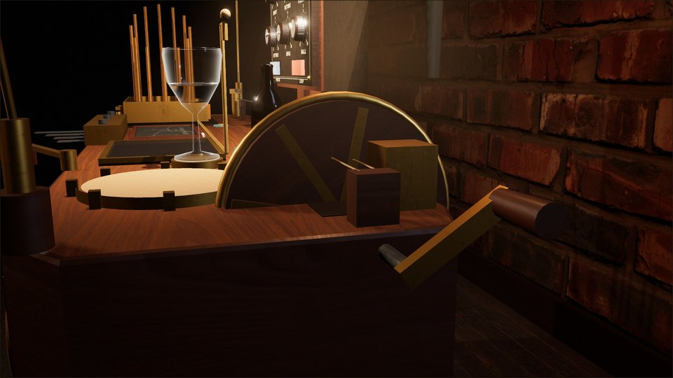
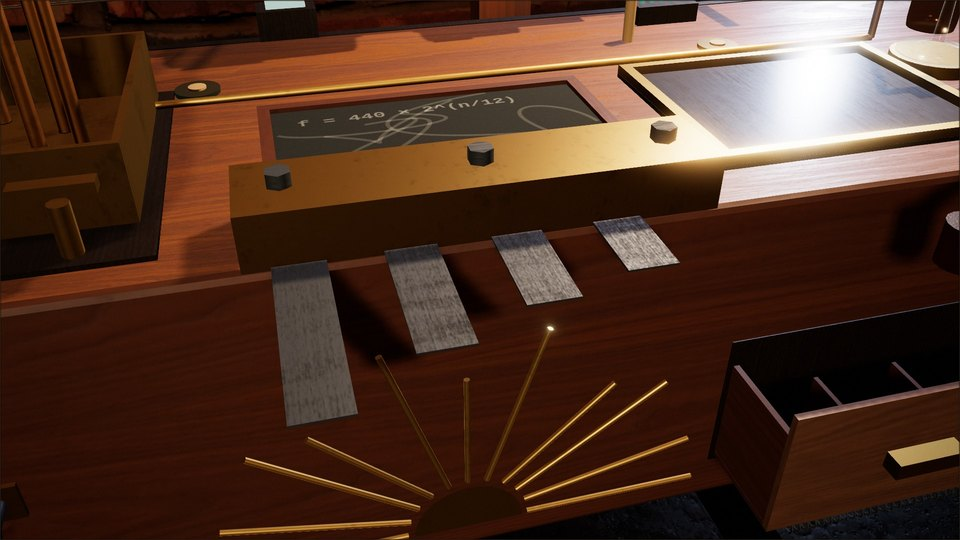
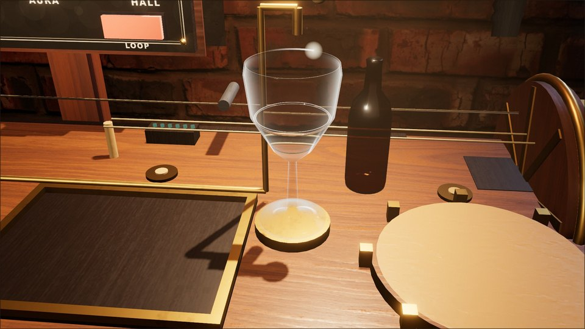
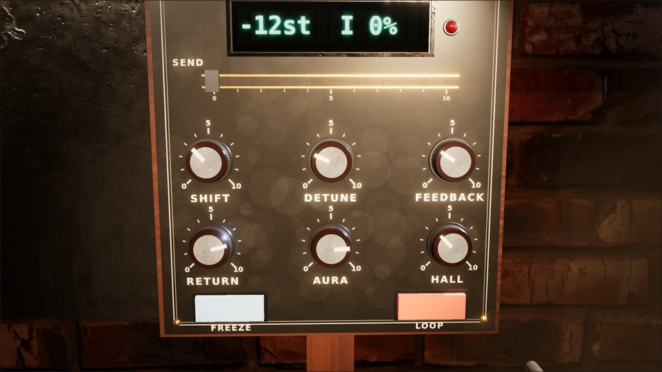
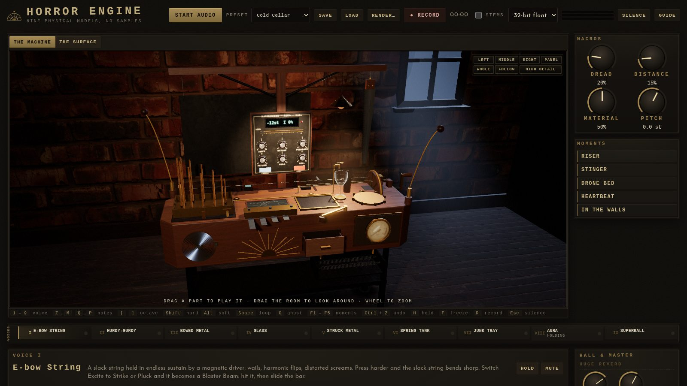
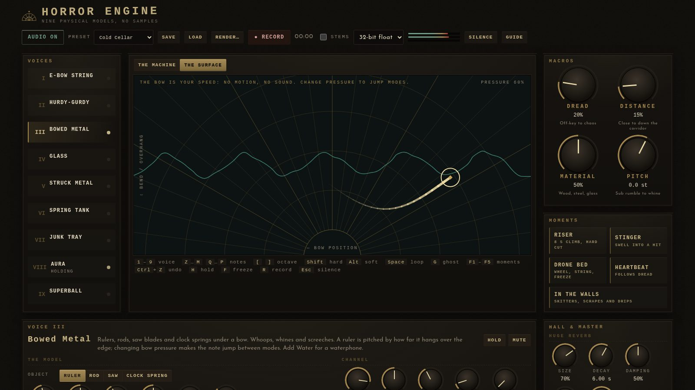

# Horror Engine

A playable machine for horror sound that runs in your browser: nine physical models bolted to one wooden box, with no samples.

[Play it in your browser](https://snazzygaz.github.io/horror-engine/) · [Run it locally](#running-it) · [Watch the intro (MP4, 64 s)](docs/media/intro_720p.mp4) · [Instrument guide](docs/INSTRUMENTS.md)

## What it is

Horror Engine is a single-page instrument for scoring slow dread. You play it with the mouse, a pen, the computer keyboard or MIDI, and you can play it two ways. In **The Machine**, a 3D view of the instrument, you bow, scrape, strike and crank each part. It has two skins, Workshop and Altar, that share every voice; only the look changes (see [Skins](#skins)). **The Surface** is a flat gesture pad for the selected voice. Each sound is synthesised live from a model of a real object: a slack string, a rosined wheel, steel rulers, glass, springs, a tray of bolts.

It owes its idea to the [Apprehension Engine](https://apprehensionengine.com/), the acoustic horror instrument conceived by composer Mark Korven and luthier Tony Duggan-Smith and built by Duggan-Smith. This project is not affiliated with either of them, and it uses none of their recordings or images. It is a separate, software take on the same idea: odd objects on a resonant box, played by hand.

## The instruments

| Object | How you play it | What it sounds like |
|---|---|---|
| I. E-bow string | Run the e-bow puck along the slack string; tap the string to strike it and drag the slide bar | Endless sustain that flips between harmonics; with a strike, a long beam boom you can bend |
| II. Hurdy-gurdy | Circle the crank; drag along the drone strings for melody | A rosined drone bed; jerk the crank and the dog buzz rattles in |
| III. Bowed metal | Stroke across a ruler, rod, saw or clock spring | Stick-slip whoops and groans that jump between modes as you change pressure |
| IV. Glass | Nail or chalk on the pane and slate, a wet finger round the wine glass or bottle | From a pure singing rim to a judder that sets your teeth on edge |
| V. Struck metal | Tap a ruler, rod, saw or coil; knock the wood, drumhead or thunder sheet | Ruler twangs, rod pings, bells and knocks, up to 12 at once |
| VI. Spring tank | Tap, drag along it to scrape, shake it up and down; Alt to e-bow it | Echoes that drip downward, highs first, lows last |
| VII. Junk tray | Open the drawer, drag the magnet over the nuts and bolts | Rattles, ticks and skitters |
| VIII. Aura | Rub the lamp; double-click it to freeze | A granular pad made from the machine's own last few seconds |
| IX. Superball | Lift a ball off its wand and drag it over the drumhead, the thunder sheet, the rods or the box | Moans and whale calls that rise as you press |

Every part is bolted to one wooden body heard through a contact mic, so a knock on the wood rings everything a little. [docs/INSTRUMENTS.md](docs/INSTRUMENTS.md) covers each voice in full: what it is, how to play it, every knob and how to use it in a score.

 
 

## Skins

The Machine has two skins. They share every hit zone, gesture and voice; only the look changes. Switch with the **Skin** button above the view, or add `?skin=altar` (or `?skin=workshop`) to the address.


| Workshop | Altar |
|---|---|
| Slack string, e-bow, slide bar | Ribcage harp strung with gut, lodestone, knuckle slide |
| Waterphone rods in a water tray | Rusted rail spikes in a tray of blood |
| Hurdy-gurdy wheel and crank | A wheel cranked through a skull on a spike, with two drone guts the wheel bows |
| Wine glass and tap | Cracked skull bowl and a bleeding spout |
| Glass pane, slate, bottle | Black mirror, grave slate, bottle |
| Steel rulers and clamp, bow saw, clock spring | Rusted blades under an iron strap, bone saw, iron serpent |
| Drumhead | Stitched hide drumhead |
| Thunder sheet | Iron plate under a beam-mounted goat skull |
| Spring tank | Rusty coils beside hanging entrails |
| Junk drawer and magnet | Drawer of bones and teeth, stirred by a claw |
| Superballs | Eyes on stalks |
| Lamp (Aura) | The altar candle |
| Brass FX panel, body sunburst | Bone dials and a carved pentagram that glows with the Body voice |

The Altar is built in code like the rest (`src/sculpt.js`, `src/altar.js`). Most of the bones and the blood are distance fields and procedural work meshed at load; the human skulls and the beam-mounted goat skull are packed scans (see [CREDITS.md](CREDITS.md)).

## The FX panel

The FX panel holds the effects that sit after the instruments:

- **SEND**, a slider: how much of the selected voice goes into the harmonizer.
- **SHIFT**, **DETUNE**, **FEEDBACK** and **RETURN**: the harmonizer. It is an octave down by default, split into two voices detuned left and right, with feedback that stacks the shift into a falling spiral.
- **AURA**: the level of the Aura pad.
- **HALL**: the decay of the large reverb.
- **FREEZE** pins the aura pad. **LOOP** records a gesture loop (Space does the same).

The looper records what your hand did, not audio, so every pass is played again by the models, and a layer handed to a Ghost keeps improvising with your strokes. The whole session can be recorded out as WAV files (see [Getting sound out](#getting-sound-out)). See [docs/FX_AND_LOOPER.md](docs/FX_AND_LOOPER.md) for the looper, stems and recording, and [docs/RECIPES.md](docs/RECIPES.md) for step-by-step patches.



## Running it

Horror Engine is one HTML page (with `vendor/three.min.js` beside it). It needs no install and no server.

1. Download or clone this repository.
2. Open `index.html` in a desktop browser. It works straight from disk (`file://`).
3. Press **Start audio**, then drag a part of the machine.

If your browser is strict about local files, serve the folder instead:

```
python3 -m http.server 8000
# then open http://localhost:8000/
```

It also runs as-is on GitHub Pages or any static host.

**Browsers.** Use a current desktop Chrome or Edge. Firefox should work. Safari has not been tested. The machine needs WebGL (WebGL 2 for the full lighting), and the audio needs Web Audio with AudioWorklet. If AudioWorklet is missing, the engine falls back to the main thread ("compatibility mode"), with more latency. Use headphones or decent speakers: a lot of this lives below 60 Hz.

**Quality.** The **High detail / Low detail** button above the machine toggles shadows, texture size and render resolution (it reloads the view). You can also add `?quality=low` or `?quality=high` to the address. Use Low on laptops with integrated graphics. The audio is the same either way. **The Surface** tab skips the 3D view entirely.



**Keys.** These are the essentials. The full list, including knob and camera keys, is in [docs/INSTRUMENTS.md](docs/INSTRUMENTS.md#keys).

| Keys | What it does |
|---|---|
| `1`–`9` | Select a voice |
| `Z`…`/`, `Q`…`P` | Play notes on the selected voice |
| `Shift` / `Alt` | Hard / soft touch |
| `Space` | Start or close a gesture loop |
| `F1`–`F5` | Moments: Riser, Stinger, Drone bed, Heartbeat, In the walls |
| `H` / `F` | Hold the voice / freeze the Aura |
| `R` | Record |
| `Esc` | Silence everything |

## Getting sound out

There is no plugin. Two ways that work:

1. **Record out.** Press **Record** (or `R`), play, then press it again. You get a zip with the mix as a WAV. With **Stems** on, you also get one WAV per voice that made a sound, plus the hall, reverse-swell, harmonizer and body returns. Drop them on your timeline at the same start point.
   - Every stem starts on the same sample as the mix and is the same length.
   - Stems are taken before the final limiter. When the limiter is idle, they add up to the mix to within rounding (about −120 dBFS). When a take hits the limiter, their sum is slightly louder than the mix.
   - Every take also includes a `.horror.json` performance file. **Render…** plays it back through the engine offline and writes the WAVs again.
2. **Loopback.** Route the browser's output into your DAW with a loopback device and record it live against picture. Use BlackHole on macOS, VB-Cable or VoiceMeeter on Windows, or PipeWire or JACK on Linux.

MIDI notes and CC 20–23 (Dread, Distance, Material, Pitch) work in browsers that support Web MIDI, once audio is started. A MIDI or VST version may come later. The recording details are in [docs/FX_AND_LOOPER.md](docs/FX_AND_LOOPER.md#recording-out).

## How it's built

It is a single HTML page that uses three.js for the machine and Web Audio for the sound. To change it, edit the files in `src/` and run `python3 build.py` (needs Pillow) to rebuild `index.html`.

## Credits and licence

Horror Engine by Garyck Arntzen ([@_mintydoge](https://x.com/_mintydoge)). MIT licence; see [LICENSE](LICENSE).

- The surface textures are CC0 scans from Poly Haven and ambientCG, listed in [CREDITS.md](CREDITS.md).
- The beam-mounted goat skull on the Altar skin is "Goat Skull" by [Bohnen](https://sketchfab.com/BOHNEN), [CC BY 4.0](https://creativecommons.org/licenses/by/4.0/) ([Sketchfab](https://sketchfab.com/3d-models/goat-skull-99b738abd7d34b27a38b363900856043)).
- three.js r160 is © the three.js authors under the MIT licence ([vendor/three.LICENSE](vendor/three.LICENSE)).
- The bowed-string friction curve follows the bow-table idea published in STK by Perry R. Cook and Gary P. Scavone. The spring tank's dispersion follows the model by Välimäki, Parker and Abel (2010).
- Inspired by the Apprehension Engine by Mark Korven and Tony Duggan-Smith; not affiliated.

Curious how it works? See [docs/UNDER_THE_HOOD.md](docs/UNDER_THE_HOOD.md).
